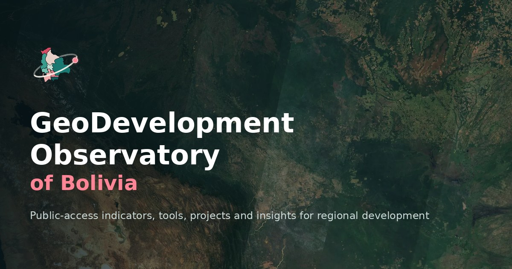

# GeoDevelopment Observatory of Bolivia (GDO-Bolivia)

[](https://quarcs-lab.github.io/gdo4bolivia/)
[](https://quarcs-lab.github.io/geo4bolivia/)
[](https://pypi.org/project/geo4bolivia/)
[](https://pypi.org/project/geo4bolivia/)
[](https://github.com/quarcs-lab/gdo4bolivia/actions/workflows/pages.yml)
[](LICENSE) [](LICENSE-DATA)
[](https://colab.research.google.com/github/quarcs-lab/gdo4bolivia/blob/main/notebooks/geo4bolivia_quickstart.ipynb)

**[Website](https://quarcs-lab.github.io/gdo4bolivia/)** · **[Python package](https://github.com/quarcs-lab/geo4bolivia)** · **[Package docs](https://quarcs-lab.github.io/geo4bolivia/)** · **[PyPI](https://pypi.org/project/geo4bolivia/)** · **[How the database works](docs/data-infrastructure.md)** · **[Quickstart notebook](https://colab.research.google.com/github/quarcs-lab/gdo4bolivia/blob/main/notebooks/geo4bolivia_quickstart.ipynb)** · **[Cite](#-citation)**

The GeoDevelopment Observatory of Bolivia is a public-access platform for analyzing, monitoring and evaluating **sustainable regional development** in Bolivia, at every spatial scale: departments, provinces, municipalities, cities and grids. It has three parts:

- **GeoDevelopment Indicators & Tools:** social, economic and environmental indicators from satellite imagery, censuses and administrative records, at every spatial scale, with the Python packages, notebooks and web apps to load, build and analyze them.
- **GeoDevelopment Projects:** research projects built on the observatory: the subnational [SDG Atlas](https://atlasods.sdsnbolivia.org/), [regional shocks and spillover effects](https://quarcs-lab.github.io/scspill/) and monitoring the space-time dynamics of local pollution.
- **GeoDevelopment Insights:** accessible research summaries.

It serves:

- **Researchers**, who need ready-made subnational panels with reproducible code
- **Decision-makers**, who design, target and evaluate regional policies
- **Citizens**, who want to understand development in their own municipality or department

Its indicators build on the [Atlas de los ODS en Bolivia 2026](https://atlasods.sdsnbolivia.org/) of SDSN Bolivia (the Sustainable Development Index, its 15 goal indices and 81 indicators near 2012 and near 2024) and on [DS4Bolivia](https://github.com/quarcs-lab/ds4bolivia) (population, night-time lights and satellite embeddings).

### Two repositories

| | This repository: [quarcs-lab/gdo4bolivia](https://github.com/quarcs-lab/gdo4bolivia) | The package: [quarcs-lab/geo4bolivia](https://github.com/quarcs-lab/geo4bolivia) |
| --- | --- | --- |
| Holds | The data (`data/`, one folder per dataset, and `geo/`), the originals and the builders that regenerate them (`raw/`, `builders/`), the notebooks and the website | The Python package `geo4bolivia`, its tests and its documentation |
| Website | [quarcs-lab.github.io/gdo4bolivia](https://quarcs-lab.github.io/gdo4bolivia/): indicators, tools, projects and insights | [quarcs-lab.github.io/geo4bolivia](https://quarcs-lab.github.io/geo4bolivia/): [get started](https://quarcs-lab.github.io/geo4bolivia/get-started.html), [articles](https://quarcs-lab.github.io/geo4bolivia/articles/) and the [function reference](https://quarcs-lab.github.io/geo4bolivia/reference/) |
| Use it | Every file is a plain URL; nothing to install | `pip install geo4bolivia` ([PyPI](https://pypi.org/project/geo4bolivia/)) |

The package reads the files of this repository, so the data can be updated without a new release of the package. Both repositories carry the same version tags: `ref="v0.9.1"` in the package loads the data as they were at that release.

## 🚀 Quickstart

```python
!pip install -q geo4bolivia                       # every snippet runs in Colab
import geo4bolivia as geo
import plotly.express as px                       # preinstalled in Colab

geo.datasets()                                    # what is available: scales, years
gdf = geo.load("sdg", years=2024, geometry=True)  # 343 municipalities, boundaries
px.choropleth_map(gdf, geojson=gdf.geometry, locations=gdf.index, color="index_sdg",
                  hover_name="name", center={"lat": -16.3, "lon": -64}, zoom=4)
```

[](https://colab.research.google.com/github/quarcs-lab/gdo4bolivia/blob/main/notebooks/docs/readme/box-1.ipynb)

The package also runs the standard analyses, each in one call that returns a figure, a table and a reading of the numbers in words:

```python
!pip install -q geo4bolivia
import geo4bolivia as geo

mpi = geo.load("sdg01", variables="sdg1_2_mpi", groups=["department"])
geo.map(mpi, "sdg1_2_mpi", year=[2012, 2024],
        scheme="fisher_jenks").show()              # both periods, common classes

res = geo.lisa(mpi, "sdg1_2_mpi", year=2024)       # where does poverty cluster?
print(res.interpret())                             # the result in words
res.fig                                            # the interactive cluster map
```

[](https://colab.research.google.com/github/quarcs-lab/gdo4bolivia/blob/main/notebooks/docs/readme/box-2.ipynb)

---

## 📊 GeoDevelopment Indicators

All data share one spatial backbone. Every unit at every scale has a **geo ID** that nests by prefix (numbered as in GADM 4.1): municipality `BO-04-17-04` (Nuestra Señora de La Paz) lies in province `BO-04-17` (Murillo), which lies in department `BO-04` (La Paz), which lies in Bolivia `BO`. INE codes, DS4Bolivia's `asdf_id` and GADM codes are kept as columns of [`geo/units.csv`](geo/units.csv). The municipalities are the 343 municipalities and indigenous autonomies (GAIOC) of SDSN Bolivia's municipal map of 2025 (`map343`), the units of the SDG Atlas 2026; provinces, departments and the country are their exact unions. The 339 municipalities of the 2015 map (`map339`) keep the same geo IDs. Each dataset is a panel with one row per unit (`geo_id`) and year, published as CSV and Parquet in a folder of its own, `data/<dataset>/`, with its documentation and metadata.

| Dataset | Title | Scale | Period | Files |
| --- | --- | --- | --- | --- |
| [`sdg`](data/sdg/) | SDG Atlas 2026: the Sustainable Development Index (IDS) and its ranking, with census population | 343 municipalities (map343) | ~2012, ~2024 | [`data/sdg/`](data/sdg/) |
| [`sdg01`](data/sdg01/) … [`sdg17`](data/sdg17/) | SDG Atlas 2026, one dataset per goal: the goal index and its 81 indicators in all | 343 municipalities (map343) | ~2012, ~2024 | [`data/sdg01/`](data/sdg01/) … |
| [`pop`](data/pop/) | Population (gridded estimates) | 339 municipalities (map339, 2015 map) | 2001–2020 | [`data/pop/`](data/pop/) |
| [`ntl`](data/ntl/) | Night-time lights per capita (log) and its long-run trend | 339 municipalities (map339, 2015 map) | 2012–2020 | [`data/ntl/`](data/ntl/) |
| [`emb`](data/emb/) | Satellite embeddings, 64 dimensions, area-weighted (`A00`–`A63`) and population-weighted (`A00_pw`–`A63_pw`) | 339 municipalities (map339, 2015 map) | 2017 | [`data/emb/`](data/emb/) |
| [`geo`](geo/) | Units, names, codes, boundaries and crosswalks for every scale and map | 805 units | — | [`geo/`](geo/) |

Each dataset's folder, `data/<dataset>/`, holds:
- `README.md`, generated: its variable dictionary, coverage, files, sources, license and how to cite it (GitHub shows it when you open the folder)
- `datapackage.json`, its [Frictionless](https://datapackage.org/) metadata, the source of truth
- one subfolder per map with the panel, e.g. `data/sdg01/map343/sdg01.csv` and `.parquet`
- in the same subfolder, the data **wide and ready to map**: `sdg01_wide.gpkg` (GeoPackage, for QGIS, ArcGIS, R or Python, with a `variables` table describing every column) and `sdg01_wide.geojson` (lighter, for web maps), one row per municipality with its name, province and department, and a column per variable and year (`sdg1_2_mpi_2012`, `sdg1_2_mpi_2024`). Each indicator page has download buttons for them

Every variable of every dataset is also listed in [`definitions_gdo-bolivia.csv`](definitions_gdo-bolivia.csv).

The SDG Atlas 2026 measures each indicator twice, near the 2012 census and near the 2024 census; the panels store the two periods as 2012 and 2024, and each variable's actual reference years are in its metadata. New municipalities keep being created in Bolivia, so the municipal maps are named by their number of units: `map343` is SDSN Bolivia's map of 2025 (the units of the SDG Atlas 2026) and `map339` GeoBolivia's map of 2015. The 339 municipalities of 2015 kept their geo IDs (numbered as in GADM 4.1) in map343, and the four units created since were numbered after them. Population, night-time lights and satellite embeddings were computed on the 2015 polygons, so they are published on map339, for all 339 municipalities. Each dataset records its map, and the package's spatial functions use it (`map=` names it when a table you built mixes them) ([how maps change](CONTRIBUTING_DATA.md#add-a-municipal-map)).

### Load the data: two ways

**1. With the package**, [geo4bolivia](https://quarcs-lab.github.io/geo4bolivia/) ([get started](https://quarcs-lab.github.io/geo4bolivia/get-started.html), [function reference](https://quarcs-lab.github.io/geo4bolivia/reference/)). It finds the variables and their documentation, and loads them as labelled panels with names and boundaries:

```python
!pip install -q geo4bolivia
import geo4bolivia as geo

geo.search("poverty")                              # variables, datasets, years
geo.info("sdg01")                                  # coverage, sources, licenses
mpi = geo.load("sdg01", variables="sdg1_2_mpi",
               groups=["department"])              # ~2012 and ~2024, with names
geo.describe(mpi)                                  # labelled summary per period
geo.change(mpi, "sdg1_2_mpi")                      # change and rank change per unit
geo.aggregate(mpi, to=["department", "country"],
              dataset="sdg01")                     # census-population weighted
geo.combine(["ntl", "pop"], scale="map339")  # two datasets, one panel
geo.load("ntl", ref="v0.9.1")                      # a frozen release of the data
geo.map(mpi, "sdg1_2_mpi", year=2024)              # interactive map (Plotly)
```

[](https://colab.research.google.com/github/quarcs-lab/gdo4bolivia/blob/main/notebooks/docs/readme/box-3.ipynb)

**2. Without the package.** Every file is a plain URL that pandas and geopandas (preinstalled in Colab, like plotly) read directly:

```python
import pandas as pd
import geopandas as gpd
import plotly.express as px

BASE = "https://raw.githubusercontent.com/quarcs-lab/gdo4bolivia/main/"
df = pd.read_csv(BASE + "data/sdg/map343/sdg.csv")   # geo_id, year, variables
units = pd.read_csv(BASE + "geo/units.csv")             # names, parents, codes
units = units[units["scale"] == "map343"]               # one map: one row per unit
gdf = gpd.read_file(BASE + "geo/boundaries/map343.geojson")   # polygons
gdf = gdf.merge(df[df.year == 2024], on="geo_id")
px.choropleth_map(gdf, geojson=gdf.geometry, locations=gdf.index, color="index_sdg",
                  hover_name="name", center={"lat": -16.3, "lon": -64}, zoom=4)
```

[](https://colab.research.google.com/github/quarcs-lab/gdo4bolivia/blob/main/notebooks/docs/readme/box-4.ipynb)

### Analyse the data

Every analysis function takes a dataset id or a table with a `geo_id` column, finds the boundaries, the spatial weights and the labels itself, and returns a result with `.fig` (an interactive Plotly figure), `.df`, `.gt` (a formatted table, where one helps) and `.interpret()` (the numbers read in words):

```python
!pip install -q geo4bolivia
import geo4bolivia as geo

res = geo.beta_convergence("sdg", "index_sdg")   # did lagging municipalities catch
print(res.interpret())                           # up between ~2012 and ~2024?
res.fig
```

[](https://colab.research.google.com/github/quarcs-lab/gdo4bolivia/blob/main/notebooks/docs/readme/box-5.ipynb)

| You want to know | Functions |
| --- | --- |
| What does a variable look like? | `describe`, `distribution`, `extremes`, `correlation`, `scatter`, `trend` |
| Is it clustered in space, and where? | `map`, `weights`, `connectivity`, `moran`, `lisa` |
| Are the units that started lower catching up? | `beta_convergence`, `sigma_convergence`, `convergence_clubs` |
| Who moved, and do neighbours matter? | `rank_mobility`, `lisa_transitions`, `transitions`, `spatial_transitions` |
| How unequal are the units, between or within which groups? | `inequality`, `theil_decomposition` |
| What goes with what, once space is accounted for? | `regression`, `panel_model`, `spatial_diagnostics`, `spatial_model` |
| Does an association change from place to place? | `mgwr` (multiscale GWR) |

The [articles](https://quarcs-lab.github.io/geo4bolivia/articles/) of the package's documentation work one question each on these data, and the [function reference](https://quarcs-lab.github.io/geo4bolivia/reference/) has an example for every function.

### Build your own indicators

The package can also:
- link your own tables to the same units, by names in any spelling or by INE and DS4Bolivia codes
- extract indicators from rasters
- move data onto grids or other zones
- save the results in the same documented format
- map and analyse them with the same functions

```python
!pip install -q "geo4bolivia[raster]"       # [raster] adds rasterio for geo.zonal()
import pandas as pd
import geo4bolivia as geo

mine = pd.DataFrame({"mun_id": [20101, 70101], "year": 2024,
                     "teachers": [9120, 11034]})
mine = geo.link(mine, scale="map343", on="mun_id",
                key="mun_id")               # INE code 20101 -> BO-04-17-04
ntl = geo.zonal("viirs_2024.tif", scale="map343",
                name="ntl", year=2024)      # your raster: ntl_sum, ntl_mean
panel = geo.combine(["sdg"], scale="map343", years=2024, extra=[ntl, mine])
geo.save(panel, "my_indicator", scale="map343", directory="my_data")
geo.map(panel, "ntl_mean", year=2024)       # maps and analyses take your panel too
```

[](https://colab.research.google.com/github/quarcs-lab/gdo4bolivia/blob/main/notebooks/docs/readme/box-6.ipynb)

The full guide is [`docs/data-infrastructure.md`](docs/data-infrastructure.md). It covers the scales and IDs, the metadata and aggregation rules, and recipes for building indicators. To add a dataset to the observatory, see [`CONTRIBUTING_DATA.md`](CONTRIBUTING_DATA.md).

### A note on DS4Bolivia's homonyms

Three pairs of municipalities share a name across departments: San Javier (Beni, Santa Cruz), El Puente (Tarija, Santa Cruz) and Santa Rosa (Beni, Pando). In DS4Bolivia, the attribute rows of each pair (names, INE codes and the SDG Atlas 2020 indicators) are attached to the other polygon of the pair. Population, lights and embeddings, which DS4Bolivia computed from the polygons, follow the polygons; the SDG Atlas 2026 comes from SDSN Bolivia and is linked by INE code. Details and evidence: [`raw/README.md`](raw/README.md).

---

## 🐍 GeoDevelopment Tools

### Python packages

| Package | What it does | Install (Google Colab) |
| --- | --- | --- |
| **[geo4bolivia](https://quarcs-lab.github.io/geo4bolivia/)** (the observatory's package; [repository](https://github.com/quarcs-lab/geo4bolivia), [reference](https://quarcs-lab.github.io/geo4bolivia/reference/)) | Find variables and their sources, licenses and actual years; load every indicator as a labelled panel with names and boundaries; compare periods; aggregate across scales with coverage; link your own data and extract indicators from rasters; and run the fundamental analyses in one call each: maps, spatial dependence, convergence, transitions, inequality, regression, panel and spatial models, multiscale GWR | `!pip install -q geo4bolivia` |
| **[expdpy](https://cmg777.github.io/expdpy/)** | A companion for specialised panel methods: within and between variation, correlated random effects, instrumental variables, event studies; `geo.for_expdpy()` prepares the observatory's data for it in one line | `!pip install -q geo4bolivia expdpy` |
| **[geometrics](https://quarcs-lab.github.io/geometrics/)** | A companion for specialised spatial methods, such as a spatial model under several weights matrices, plain GWR and teaching sandboxes; `geo.for_geometrics()` prepares the observatory's data for it in one line | `!pip install -q geo4bolivia geometrics` |

geo4bolivia covers the fundamentals on its own; the two companions take over where a study needs a specialised method. Its default install runs loading, maps and the core analyses. Extras add the libraries of a few methods: `"geo4bolivia[dynamics]"` (Markov transitions), `[mgwr]` (multiscale GWR), `[panel]` (panel models), `[raster]` (zonal statistics), or `[all]`.

### Cloud-based notebooks

| Notebook | Description |
| --- | --- |
| [Find, load and understand the data with geo4bolivia](https://colab.research.google.com/github/quarcs-lab/gdo4bolivia/blob/main/notebooks/geo4bolivia_quickstart.ipynb) | The package tutorial: discover datasets and their documentation, load with and without the package, describe and map, compare ~2012 with ~2024, move across scales, link your own table, and build and save an indicator from a raster |
| [One question, three packages](https://colab.research.google.com/github/quarcs-lab/gdo4bolivia/blob/main/notebooks/three_packages.ipynb) | Did municipalities converge in sustainable development, ~2012 to ~2024? geo4bolivia answers it (maps, β-convergence, inequality, spatial clusters); expdpy and geometrics each take it one specialised step further |
| [Exploratory data analysis](https://colab.research.google.com/github/quarcs-lab/gdo4bolivia/blob/main/notebooks/eda.ipynb) | Multidimensional poverty in 2012 and 2024, its change, census population and night-time lights: summaries, departments, treemaps and scatter plots |
| [Exploratory spatial data analysis](https://colab.research.google.com/github/quarcs-lab/gdo4bolivia/blob/main/notebooks/esda.ipynb) | Maps, spatial weights, Moran's I and LISA clusters of multidimensional poverty in 2012 and 2024 |
| [Spatial distribution and dependence](https://colab.research.google.com/github/quarcs-lab/gdo4bolivia/blob/main/notebooks/esda_dependence.ipynb) | Box-plot and Fisher-Jenks maps, KNN weights, the spatial lag, Moran's I and LISA clusters at two significance levels |
| [Spatial inequality](https://colab.research.google.com/github/quarcs-lab/gdo4bolivia/blob/main/notebooks/esda_inequality.ipynb) | Gini, Theil decomposition between and within departments, spatial Gini of poverty (2012, 2024) and lights |
| [Spatial heterogeneity (MGWR)](https://colab.research.google.com/github/quarcs-lab/gdo4bolivia/blob/main/notebooks/esda_heterogeneity.ipynb) | Where night-time lights predict poverty better or worse: a multiscale geographically weighted regression |
| [Extended EDA and ESDA](https://colab.research.google.com/github/quarcs-lab/gdo4bolivia/blob/main/notebooks/eda_esda.ipynb) | A full workflow on poverty, infrastructure and lights: statistics, correlations, clusters and bivariate maps |
| [Predicting poverty from satellite embeddings](https://colab.research.google.com/github/quarcs-lab/gdo4bolivia/blob/main/notebooks/embeddings_mpi_ml.ipynb) | Random forest and XGBoost predict multidimensional poverty from 64 embedding dimensions, with random and spatial (leave-one-department-out) cross-validation and residual maps |
| [Dynamics of sustainable development, 2012–2024](https://colab.research.google.com/github/quarcs-lab/gdo4bolivia/blob/main/notebooks/sdg_dynamics.ipynb) | Change in the Sustainable Development Index and its 15 goals, β-convergence, inequality, rank mobility and spatial clusters of progress |

### Web apps

- [GeoExplorer v1.0 — Bolivia](https://carlos-mendez.projects.earthengine.app/view/geoexplorer1v100bolivia): space-time dynamics of population, night-time lights, land cover and GDP, 2013–2019 (source in [`apps/`](apps/))

---

## 🧭 GeoDevelopment Projects

| Project | What it does |
| --- | --- |
| [The subnational SDG Atlas of Bolivia](https://atlasods.sdsnbolivia.org/) | SDSN Bolivia's municipal indices of the Sustainable Development Goals, ~2012 and ~2024; its 2026 edition is the `sdg` and `sdg01`…`sdg17` datasets |
| [Regional shocks and spillover effects](https://quarcs-lab.github.io/scspill/) | `scspill`: synthetic control when a shock spills over to neighbouring regions |
| Monitoring space-time dynamics of local pollution | satellite monitoring of local air pollution across municipalities (website coming soon) |

---

## 💡 GeoDevelopment Insights

Research that uses the observatory's data, summarised in plain language on the [website](https://quarcs-lab.github.io/gdo4bolivia/#insights):

| Insight | Paper |
| --- | --- |
| [Human capital constraints and the regions of Bolivia](https://quarcs-lab.github.io/gdo4bolivia/insights/human-capital-paper/) | Mendez, C., & Gonzales, E. (2021). Human capital constraints, spatial dependence, and regionalization in Bolivia: A spatial clustering approach. *Economía*, 44(87), 115–145. https://doi.org/10.18800/economia.202101.007 |

---

## 🛠️ For developers

### Repository structure

```text
gdo4bolivia/
├── site/                         # The website: React + Tailwind sources, build.mjs, map boundaries (data/)
├── robots.txt, site.webmanifest
├── project.yaml                  # Project identity: name, package, repository, country codes, map settings
├── raw/                          # Original inputs, never edited (see raw/README.md)
├── builders/                     # geo.py + one builder per dataset: raw/ -> geo/, data/
├── geo/                          # Spatial backbone: scales.yaml, units, boundaries/, crosswalks/
├── data/<dataset>/               # One folder per dataset: datapackage.json (the metadata, source of truth),
│                                 #   README.md and <map>/<dataset>.csv + .parquet (generated); index.json
├── docs/                         # data-infrastructure.md (the guide)
├── definitions_gdo-bolivia.csv   # All variables of all datasets (generated)
├── tests/                        # test_data.py (validation, builders) + test_project.py (Bolivia facts)
├── notebooks/                    # Colab notebooks (.ipynb) paired with MyST markdown (.md)
├── apps/                         # Earth Engine app source code
├── code/                         # Pointers to data-preparation code
├── scripts/                      # web_boundaries.py, indicator maps, site images, new_project.py (template)
├── images/                       # Site assets
├── .github/workflows/            # pages.yml (builds and deploys the website)
├── CONTRIBUTING_DATA.md          # How to add a dataset, a scale or a municipal map
├── TEMPLATE.md                   # The two-repository layout and the geo4<country> template
├── pyproject.toml, uv.lock       # Environment (uv): the geo4bolivia package and the notebooks' libraries
└── CITATION.cff, LICENSE (code), LICENSE-DATA (data), CLAUDE.md
```

The Python package is not in this repository: its code, tests and documentation are in [quarcs-lab/geo4bolivia](https://github.com/quarcs-lab/geo4bolivia). This repository installs it as a dependency.

### Run locally

```bash
uv sync                          # environment: the geo4bolivia package (every extra) + the notebooks' libraries
uv run geo4bolivia build         # regenerate geo/ and data/ from raw/ with builders/
uv run geo4bolivia validate      # check IDs, schemas, nesting and file consistency
uv run pytest                    # the data validate, every dataset has a builder, Bolivia facts
uv run jupyter lab notebooks/    # open the notebooks
npm ci --prefix site             # website build tools (Node 20+), once
npm run --prefix site preview    # build the website and serve it at http://localhost:8765/
```

The `geo4bolivia` command comes from the package, which finds this checkout and runs the builders in `builders/`. While a new version of the package is being developed, `[tool.uv.sources]` in `pyproject.toml` installs it from a checkout next to this repository instead of PyPI.

### Releases

The package is released on PyPI from its own repository ([`RELEASING.md`](https://github.com/quarcs-lab/geo4bolivia/blob/main/RELEASING.md)). At each release this repository gets the same `vX.Y.Z` tag, so `geo.load("ntl", ref="v0.9.1")`, or a raw URL with `v0.9.1` in place of `main`, returns the data as they were at that release.

### Part of a family of projects

GDO-Bolivia was created from [geo4cambodia](https://github.com/quarcs-lab/geo4cambodia), the template of a family of `geo4<country>` projects. They share one design: geo IDs, long panels, Frictionless metadata and the same package API. Every project-specific setting lives in `project.yaml`. Since version 0.6 the package and the data live in two repositories. See [`TEMPLATE.md`](TEMPLATE.md).

### The website

The site's sources are in `site/`: a React app (`site/src/app.jsx`) whose items (indicators, packages, notebooks, apps, projects, insights, events) are entries of the `CONTENT_REGISTRY` array in `site/src/content.js`. `site/build.mjs` bundles it with esbuild and Tailwind and pre-renders a page for every item at `<section>/<id>/`, with its own preview card and structured data, plus the sitemap, the search index and the data of the interactive maps. The [website workflow](.github/workflows/pages.yml) builds and deploys it to GitHub Pages on every push to `main`. The maps draw SDSN Bolivia's municipal boundaries of 2025, simplified for the web by `scripts/web_boundaries.py`.

---

## 👥 Team

- [Carlos Mendez](https://carlos-mendez.org) (Nagoya University, Japan)

**Contact:** carlos.mendez.n9 [at] f.mail.nagoya-u.ac.jp

**Community:** questions and ideas are welcome in [GitHub Discussions](https://github.com/quarcs-lab/gdo4bolivia/discussions).

---

## 📝 Citation

> Mendez, C. (2026). *GeoDevelopment Observatory of Bolivia*. <https://quarcs-lab.github.io/gdo4bolivia/>

```bibtex
@misc{gdobolivia2026,
  author       = {Mendez, Carlos},
  title        = {{GeoDevelopment Observatory of Bolivia}},
  year         = {2026},
  howpublished = {\url{https://quarcs-lab.github.io/gdo4bolivia/}},
  note         = {Data and notebooks: https://github.com/quarcs-lab/gdo4bolivia}
}
```

To cite the Python package, see [its README](https://github.com/quarcs-lab/geo4bolivia#cite).

When you use a dataset, cite its original sources first, then the observatory, which processes and maintains the data, then its other sources. Each dataset's README (`data/<dataset>/`) and page on the website list them in that order, and `geo.cite("<dataset>")` prints them.

---

**Disclaimer.** The indicators, tools, projects and insights are the responsibility of the individual researchers and do not necessarily represent the views of their affiliated institutions or related organizations. Maps are for geo-statistical use only. They have a referential, informational character and do not represent an official definition of Bolivia's territorial boundaries.

**License.** Code: [MIT](LICENSE). Data: [CC BY 4.0](LICENSE-DATA), except where an original source requires otherwise. The boundaries (`geo/boundaries/`) are SDSN Bolivia's municipal map of 2025 and the SDG data come from SDSN Bolivia's Atlas de los ODS en Bolivia 2026, both licensed by SDSN Bolivia under CC BY 4.0 (cite “SDSN Bolivia (2025). Límites Municipales Bolivia 2025 [Archivo shapefile]. https://sdsnbolivia.org/datos-espaciales/” and the Atlas). Each dataset's sources, their licenses and the credits they ask for are listed in its metadata and README (`data/<dataset>/`) and on its page on the website; cite its original sources first, then the observatory, then the other sources (`geo.cite("<dataset>")`). The indicator maps use Esri's World Dark Gray Canvas basemap (Esri, HERE, Garmin, © OpenStreetMap contributors). Section illustrations come from the geo4cambodia template (generated with OpenAI image generation via Codex); satellite imagery in the hero and the section backgrounds is Sentinel-2 cloudless 2016 by EOX IT Services GmbH (CC BY 4.0), except the Laguna Verde background from Sentinel-2 cloudless 2024 (CC BY-NC-SA 4.0), and NASA Blue Marble (public domain).
