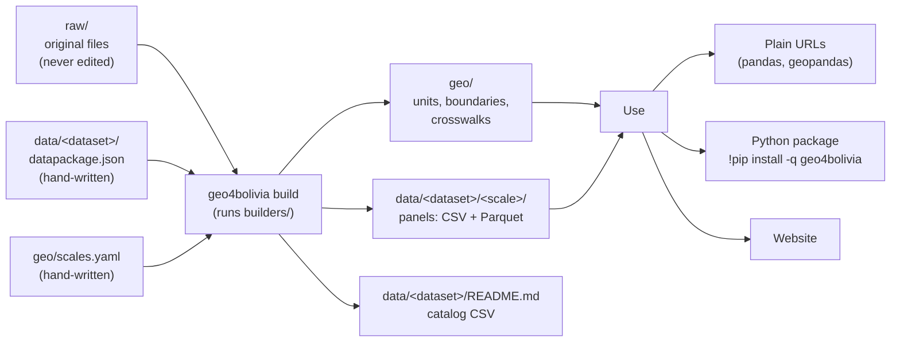

# How the data infrastructure works

This guide explains the **indicators database** behind the observatory: how spatial units, datasets and metadata fit together, how to load data (with or without the Python package), and how to build and analyse your own indicators with the package, for example in Google Colab.

> The database lives in this repository, [quarcs-lab/gdo4bolivia](https://github.com/quarcs-lab/gdo4bolivia), with its builders, the notebooks and the observatory's website. The Python package, **geo4bolivia**, lives in its own repository, [quarcs-lab/geo4bolivia](https://github.com/quarcs-lab/geo4bolivia), with its documentation at <https://quarcs-lab.github.io/geo4bolivia/>; it reads the files described here.
>
> The design comes from the [geo4cambodia](https://github.com/quarcs-lab/geo4cambodia) template, so every `geo4<country>` project works the same way with its own package name, country code and datasets. See [`TEMPLATE.md`](../TEMPLATE.md).

**Contents**

1. [The big picture](#1-the-big-picture)
2. [Spatial scales and geo IDs](#2-spatial-scales-and-geo-ids)
3. [The geography layer](#3-the-geography-layer-geo)
4. [The indicators database](#4-the-indicators-database)
5. [Loading data: two ways](#5-loading-data-two-ways)
6. [Building your own indicators](#6-building-your-own-indicators-with-the-package)
7. [Package reference](#7-package-reference)
8. [Maintaining the database](#8-maintaining-the-database)
9. [Design decisions](#9-design-decisions)

---

## 1. The big picture



Four rules hold everything together:

1. **Every spatial unit has one geo ID** (`geo_id`), at every scale. IDs nest by prefix: municipality `BO-04-17-04` (La Paz) lies in province `BO-04-17` (Murillo), which lies in department `BO-04` (La Paz), which lies in `BO`.
2. **Every dataset is a long panel**: one row per unit (`geo_id`) and `year`, one column per variable, stored in its own folder as `data/<dataset>/<scale>/<dataset>.csv` and `.parquet`.
3. **Metadata is the source of truth.** A Frictionless datapackage per dataset (`data/<dataset>/datapackage.json`) describes every variable (description, unit, source, aggregation rule). Documentation is generated from it.
4. **Nothing published is edited by hand.** Original inputs stay untouched in `raw/`; `geo4bolivia build` runs the builders in `builders/`, which regenerate `geo/` and `data/` (each dataset's files and README), and `geo4bolivia validate` checks them. Both commands come from the package.

| Folder or file | What it holds | Edited by hand? |
| --- | --- | --- |
| `project.yaml` | Project identity: name, package, GitHub repository, country code, equal-area projection | yes |
| `geo/scales.yaml` | The registry of spatial scales and their ID patterns | yes |
| `raw/` | Original inputs (data, boundaries, lookup tables) | added, never edited |
| `data/<dataset>/datapackage.json`, `data/index.json` | Dataset descriptions and the list of datasets | yes |
| `builders/` | One builder per dataset, the geography builder, and their registry (`__init__.py`); they use the package's helpers (`geo4bolivia.build`) | yes |
| `geo/units.*`, `geo/boundaries/`, `geo/crosswalks/` | The geography layer | generated |
| `data/<dataset>/<scale>/<dataset>.*` | Published panels | generated |
| `data/<dataset>/README.md`, `data/README.md`, the catalog CSV | Documentation | generated |

---

## 2. Spatial scales and geo IDs

A **scale** is a set of units that tile the country: departments, provinces, municipalities, grid cells... Scales are registered in [`geo/scales.yaml`](../geo/scales.yaml):

```yaml
municipality:
  label: Municipality (343)
  kind: admin            # admin | grouping | grid | custom
  level: 3               # administrative level
  parent: province       # the next coarser scale it nests in exactly
  id_pattern: '^BO-\d{2}-\d{2}-\d{2}$'
  example: BO-04-17-04
  source: SDSN Bolivia (2025), Límites Municipales Bolivia 2025, numbered as GADM 4.1 level 3
  status: active         # active: published in geo/ | planned: reserved
```

| Field | Meaning |
| --- | --- |
| `kind` | `admin`: administrative units that nest by ID prefix. `grouping`: unions of whole units of another scale (set `children:`). `grid`: regular cells. `custom`: any other zones (watersheds, historical boundaries) |
| `parent` | Coarser scale every unit lies in exactly. Defines the hierarchy used by `aggregate()` |
| `children` | For a grouping: the scale whose whole units it unites (e.g. statistical regions made of whole departments) |
| `id_pattern` | Regular expression every ID of the scale must match. Patterns must not overlap, so an ID tells its scale |
| `digits` | Zero-padding of this level's part of the ID (default 2) |
| `status` | `planned` reserves the scale and its ID scheme before data exist |

**Geo IDs in geo4bolivia**

| Scale | Units | Pattern | Example | Nests in |
| --- | --- | --- | --- | --- |
| `country` | 1 | `BO` | `BO` | — |
| `department` | 9 | `BO-NN` | `BO-04` (La Paz) | country |
| `province` | 113 | `BO-NN-NN` | `BO-04-17` (Murillo) | department → country |
| `map343` | 343 | `BO-NN-NN-NN` | `BO-04-17-04` (Nuestra Señora de La Paz) | province → department → country |
| `map339` | 339 | `BO-NN-NN-NN` | `BO-04-17-04` (the same municipality, on the 2015 map) | province → department → country (by ID) |
| `grid10k` | planned | `BO-G10K-rNNNcNNN` | `BO-G10K-r012c034` | (overlay) |

Administrative numbers follow the GADM order; the boundaries are SDSN Bolivia's municipal map of 2025 (343 municipalities and indigenous autonomies, licensed by SDSN Bolivia under CC BY 4.0), attached to the IDs by INE code (`scripts/match_municipalities343.py`, `builders/geo.py`, and the package's `geo4bolivia.build.geoboundaries`); the four units created after GADM's map are numbered after the last municipality of their province. The map leaves salt flats and lakes outside every unit, so they are holes at every scale and `area_km2` excludes them. Codes from other sources are **kept as columns**, never used as keys: Bolivia's INE codes order the departments differently (La Paz is `BO-04` here and `02` in INE), so `ine_code` is a column of `geo/units.csv`, next to DS4Bolivia's `asdf_id` and the INE `mun_id`.

**Municipal maps, named by their number of units.** New municipalities are created over time, so each municipal map is a scale of its own named `map<units>`. `map343` is SDSN Bolivia's map of 2025 (the SDG Atlas 2026); `map339` is GeoBolivia's map of 2015 (339 municipalities, as geoBoundaries publishes it, public domain), on whose polygons DS4Bolivia computed `pop`, `ntl` and `emb`, which are therefore published on it. The 339 municipalities kept their IDs in map343 and the 4 new units got new ones, so an ID never changes meaning, and the two maps **share geo IDs**: six municipalities (Colquechaca, Mizque, Porco, Tomave, San Ignacio, Santa Ana) have one ID and two outlines. That is why each dataset records its map (`geo:scale` in its metadata, and `df.attrs["geo:scale"]` on what `geo.load()` returns) and every spatial function of the package takes `map=` for a table that does not say. map339's units nest in map343's provinces by ID (`nesting: ids` in `scales.yaml`); `geo/crosswalks/map339__map343.csv` gives the share of each 2015 unit's area in each 2025 unit, to move data between the maps (`geo.overlay()`). See [`CONTRIBUTING_DATA.md`](../CONTRIBUTING_DATA.md).

---

## 3. The geography layer (`geo/`)

| File | Contents |
| --- | --- |
| `units.csv` / `.parquet` | One row per unit of every scale and map (filter on `scale` before joining on `geo_id`): `geo_id`, `scale`, `name`, `parent_id`; one `<scale>_id` column per scale it lies in (`country_id`, `department_id`, `province_id`, `map343_id`, `map339_id`); a municipality has a row on each map it is on, so `geo_id` is unique within a scale; source keys (`gid` = GADM, `ine_code` = INE, and for municipalities `asdf_id` = DS4Bolivia polygon, `mun_id` = INE code as an integer); DS4Bolivia's and GADM's spellings (`name_ds4bolivia`, `name_gadm`); `area_km2` |
| `boundaries/<scale>.geojson` / `.parquet` | Polygons in WGS 84 with `geo_id` and `name`, one file per scale and map (`map343`, `map339`). Coarser scales are dissolved from map343, so they nest exactly |
| `crosswalks/<from>__<to>.csv` | `geo_id_from`, `geo_id_to`, `weight_area` for every nested pair, finer to coarser (`map343__province.csv`), and between the two maps (`map339__map343.csv`, area shares) |

The `<scale>_id` columns make any join across scales a one-liner: every municipality row already says its province, department and country.

---

## 4. The indicators database

### Datasets

A **dataset** is a set of variables from one source, published at one or more scales, in a folder of its own:

```
data/ntl/
├── README.md              generated: dictionary, coverage, files, sources, license, citations
├── datapackage.json       the metadata (hand-written; the build adds the coverage fields)
└── map339/
    ├── ntl.csv            geo_id, year, asdf_id, ln_NTLpc, ln_t400NTLpc
    └── ntl.parquet        the same table, typed and compressed
```

On GitHub, opening a dataset's folder shows its README. The observatory's website links each dataset to its folder (the table "Database architecture").

Each table is a **long panel**: one row per unit and year, sorted by `geo_id` and `year`. Optional `source_key` columns (here `asdf_id`) keep the original identifier next to `geo_id` for traceability. Wide tables (one column per year) are produced on demand, never stored.

| Dataset | Scale | Years | Variables |
| --- | --- | --- | --- |
| `sdg` | map343 (343) | 2012, 2024 | SDG Atlas 2026: the Sustainable Development Index (IDS), its ranking, census population and urbanization |
| `sdg01` … `sdg17` | map343 (343) | 2012, 2024 | SDG Atlas 2026, one dataset per goal: the goal index and its indicators (81 in all) |
| `pop` | map339 (339) | 2001–2020 | gridded population |
| `ntl` | map339 (339) | 2012–2020 | log night-time lights per capita and its HP trend |
| `emb` | map339 (339) | 2017 | 64 satellite embedding dimensions, area-weighted (`A00`–`A63`) and population-weighted (`A00_pw`–`A63_pw`) |

Sources measured at a few points in time fit the same shape. The SDG Atlas 2026 measures each indicator twice, near the 2012 census and near the 2024 census, from sources of different years (e.g. poverty from the 2012 and 2024 censuses, child malnutrition from the 2008 and 2023 health surveys, crop production as averages of 2013–15 and 2022–24). Its datasets store the two periods at the nominal years 2012 and 2024, so every variable can be compared between them, and each field's `geo:reference_years` gives the actual years behind each stored year.

### Metadata

`data/<dataset>/datapackage.json` is a [Frictionless Data Package](https://datapackage.org/) with one resource per scale. Project-specific information lives in `geo:` properties:

| Level | Property | Meaning |
| --- | --- | --- |
| package | `name`, `title`, `description`, `licenses`, `sources` | standard Frictionless fields; `licenses` is the license of the published files (CC BY 4.0 unless a source requires otherwise) |
| package | `geo:categories`, `geo:notes`, `geo:notebooks` | shown on the dataset page |
| package | `geo:map` | the website's headline map: `{"variable", "year"}`, optionally `"scale"`, `"classify": "log"` and `"panels": [first, last]` (the page map shows each year side by side) (checked by `validate`) |
| package | `geo:updated` | date of the last update, shown in the page's License section |
| package | `geo:weights` | where a `weighted_mean:<field>` weight lives when it is not a field of the dataset, e.g. `{"population": "sdg"}`: `aggregate()` and `combine()` load it from there (checked by `validate`) |
| source | `title`, `path` | full citation (APA) and its DOI or URL; the dataset's citations list the original sources, then the observatory (`citation` in `project.yaml`), then the others |
| source | `geo:role`, `geo:creator`, `geo:homepage` | `original` (produced the data) or `intermediary` (a tool, repository or boundary set it passed through); who made it; the data's home page |
| source | `geo:license`, `geo:attribution` | the source's own license (`{name, title, path}`) and the credit sentence it asks for |
| resource | `path` | public URL of the CSV (checked by `validate`) |
| resource | `geo:scale`, `geo:period` | the scale and `[first, last]` year |
| resource | `geo:years`, `geo:units` | every year with rows (e.g. `[2012, 2024]`) and the number of units with rows; written by the build from the data (checked by `validate`) and shown by `geo.datasets()` |
| resource | `geo:path`, `geo:parquet` | file paths inside the repository, `data/<dataset>/<scale>/<dataset>.csv` and `.parquet` (checked by `validate`) |
| resource | `geo:source_geometry` | polygons the values were computed on, if different from `geo/boundaries` |
| field | `type`, `constraints` | standard Table Schema (`pattern`, `minimum`, `maximum`, `required`) |
| field | `title`, `description` | the label for plots and how the variable was built; required for every field (checked by `validate`) |
| field | `geo:role` | `id`, `time`, `source_key` (with `geo:units_column`) or `variable` (default) |
| field | `geo:unit`, `geo:source` | unit of measure and source of the variable |
| field | `geo:aggregation` | how the variable moves to coarser scales (below) |
| field | `geo:reference_years` | for panels stored at nominal years: the actual reference years behind each stored year, e.g. `{"2012": "2008", "2024": "2023"}` (checked by `validate`) |

`data/index.json` lists the dataset ids, so remote users can discover them.

### Aggregation rules

| Rule | Use for | Example |
| --- | --- | --- |
| `sum` | counts and totals | population, GDP, zonal sums of lights |
| `weighted_mean:<field>` | rates and averages, weighted by another field (of the dataset, or of the dataset `geo:weights` names) | every SDG indicator, weighted by census `population` from `sdg` |
| `mean`, `min`, `max` | unweighted summaries (use with care) | — |
| `none` | values that cannot be aggregated without more data | logs, HP trends, per-capita values without population |

`aggregate()` raises an error for `none` variables you ask for explicitly and otherwise leaves them out with a warning; `combine()` drops them with a warning. Pass `rules=` to keep them. Every result has `n_units` (the units that contributed) and `coverage` (their share of all the units in the target): a dataset with gaps shows them there; night-time lights, for example, have no raw value for a few municipalities in some years.

The SDG Atlas's indicators, goal indices and IDS aggregate as census-population-weighted means (`weighted_mean:population`: the 2012 census for ~2012, the 2024 census for ~2024), with the weights loaded from the `sdg` dataset through `geo:weights`. These are approximations of the department and national values, not the Atlas's own figures. The ranking does not aggregate (`none`). `overlay()` needs you to say which variables are *extensive* (totals, split by area) and which are *intensive* (rates, area-weighted means).

---

## 5. Loading data: two ways

All code below assumes **Google Colab**: each block starts with the line that installs what Colab lacks, so it runs in a new notebook once you replace placeholder inputs (your own tables, rasters or zones).

### A. Without the package

Every file is a plain URL: `https://raw.githubusercontent.com/quarcs-lab/gdo4bolivia/main/<path>`. Use `main` for the latest data, or a release tag (e.g. `v0.9.0`) for a frozen version. pandas, geopandas and plotly are preinstalled in Colab, so nothing needs installing:

```python
import pandas as pd
import geopandas as gpd
import plotly.express as px

BASE = "https://raw.githubusercontent.com/quarcs-lab/gdo4bolivia/main/"

df = pd.read_csv(BASE + "data/ntl/map339/ntl.csv")               # panel: geo_id, year, variables
units = pd.read_csv(BASE + "geo/units.csv")                             # names, parents, source keys
units = units[units["scale"] == "map339"]                               # one row per unit of ntl's map
df = df.merge(units[["geo_id", "name", "department_id"]], on="geo_id")

gdf = gpd.read_file(BASE + "geo/boundaries/map339.geojson")             # ntl's map: polygons with geo_id, name
gdf = gdf.merge(df.loc[df.year == 2020, ["geo_id", "ln_NTLpc"]], on="geo_id")
px.choropleth_map(gdf, geojson=gdf.geometry, locations=gdf.index, color="ln_NTLpc",
                  hover_name="name", center={"lat": -16.3, "lon": -64}, zoom=4).show()

xw = pd.read_csv(BASE + "geo/crosswalks/map343__department.csv")  # municipality -> department
```

[](https://colab.research.google.com/github/quarcs-lab/gdo4bolivia/blob/main/notebooks/docs/data-infrastructure/box-1.ipynb)

### B. With the package (Python)

```python
!pip install -q geo4bolivia
import geo4bolivia as geo

geo.datasets()                                   # datasets x scales: years, units
geo.search("poverty")                            # variables matching words
geo.info("sdg03")                                # coverage, sources, licenses
geo.dictionary("ntl")                            # variables, labels, units, rules
geo.reference_years("sdg03")                     # actual years behind 2012, 2024
print(geo.cite("sdg03"))                         # how to cite it, with its credits
df  = geo.load("ntl")                            # panel: geo_id, year, variables
df  = geo.load("ntl", groups=["department"])     # + unit name and department name
gdf = geo.load("ntl", years=2020, geometry=True) # GeoDataFrame, ready to map
w   = geo.load("pop", wide="pop")                # wide: pop2001 ... pop2020
mpi = geo.load("sdg01", variables="sdg1_2_mpi",
               years=2012)                       # one SDG indicator, ~2012
names = geo.units("map343")                # names, parents, source keys
shapes = geo.boundaries("department")
xw = geo.crosswalk("map343", "department")
sdg = geo.load("sdg", groups=["department"])     # the Sustainable Development Index
geo.describe(sdg)                                # summary per year, with labels
geo.change(sdg, "index_sdg")                     # first-to-last change and ranks
geo.load("ntl", ref="v0.9.0")                    # a frozen release of the data
geo.map(sdg, "index_sdg", year=[2012, 2024],
        scheme="fisher_jenks")                   # interactive map, both periods
```

[](https://colab.research.google.com/github/quarcs-lab/gdo4bolivia/blob/main/notebooks/docs/data-infrastructure/box-2.ipynb)

Inside a clone of this repository the package reads the local files (or set `GEO4BOLIVIA_DATA_DIR` to a clone). Anywhere else it downloads them from GitHub, caching each file for the session. `ref=` always reads from GitHub.

| | Without the package | With the package |
| --- | --- | --- |
| Install (Colab) | nothing | `!pip install -q geo4bolivia` |
| What a variable is | read `data/<dataset>/README.md` or `datapackage.json` | `geo.search()`, `geo.info()`, `geo.dictionary()`, `geo.reference_years()`, `geo.cite()` |
| Names, boundaries | merge `geo/units.csv`, `geo/boundaries/*.geojson` yourself | `names=True`, `groups=[...]`, `geometry=True`, `geo.units()` |
| Summaries, change, maps | by hand | `geo.describe()`, `geo.change()`, `geo.labels()`, `geo.map()` (one year, several, or the change) |
| Filters, wide format | by hand | `years=`, `variables=`, `wide=` |
| Across scales | join a crosswalk and aggregate by hand | `geo.aggregate()`, `geo.overlay()`, `geo.combine()` |
| Your own data | — | `geo.link()`, `geo.zonal()`, `geo.check()`, `geo.save()` |
| Analyses | write them yourself with esda, spreg, statsmodels... | one call each: `geo.moran()`, `geo.lisa()`, `geo.beta_convergence()`, `geo.inequality()`, `geo.panel_model()`, `geo.spatial_model()`, `geo.mgwr()` and more ([section 7](#7-package-reference)) |
| Specialised methods | prepare inputs yourself | `geo.for_expdpy()` → [expdpy](https://cmg777.github.io/expdpy/), `geo.for_geometrics()` → [geometrics](https://quarcs-lab.github.io/geometrics/) |

---

## 6. Building your own indicators with the package

Everything below runs in Google Colab. Each block starts with its install line: `!pip install -q geo4bolivia`, or the extra it needs, `"geo4bolivia[raster]"` when it uses `zonal()` (it adds rasterio) and `"geo4bolivia[panel]"` for `panel_model()`. Recipes 1 to 5 build the data, 6 to 8 analyse them, and 9 contributes them.

### Recipe 1: link your own table by unit names or codes

Data from a report, survey or ministry usually identifies units by name, often spelled differently. `geo.link()` attaches `geo_id`, ignoring accents, case, spaces and punctuation, and tries every name and code column of `geo.units()`:

```python
!pip install -q geo4bolivia
import pandas as pd
import geo4bolivia as geo

mine = pd.DataFrame({
    "Departamento": ["La Paz", "SANTA CRUZ", "Potosi"],
    "year": [2020, 2020, 2020],
    "schools": [4875, 3712, 2361],
})
mine = geo.link(mine, scale="department", on="Departamento")   # adds geo_id: BO-04, BO-08, BO-07
geo.check(mine, scale="department")                             # [] means it is a valid panel

# DS4Bolivia tables and INE statistics: link by their codes
codes = pd.DataFrame({"mun_id": [20101, 70101], "teachers": [9120, 11034]})
codes = geo.link(codes, scale="map343", on="mun_id", key="mun_id")   # BO-04-17-04, BO-08-01-05
```

[](https://colab.research.google.com/github/quarcs-lab/gdo4bolivia/blob/main/notebooks/docs/data-infrastructure/box-3.ipynb)

Unmatched values raise an error that suggests the closest spelling (`errors="warn"` to continue). Pass `key=` to match a specific code: `"gid"` (GADM), `"ine_code"` (INE, as text with leading zeros, e.g. `"020101"`), `"mun_id"` (INE, as a number) or `"asdf_id"` (DS4Bolivia polygon).

Some names are shared by several units: eight municipality names (El Puente, Entre Ríos, San Javier, San Lorenzo, San Ramón, Santa Rosa and Totora twice each, San Pedro three times) and four provinces called Cercado. `geo.link()` never guesses between them: such rows stay unlinked and the error lists the candidate units, so link municipalities by code where you can.

### Recipe 2: extract an indicator from a raster

Summarise any GeoTIFF (an Earth Engine export, WorldPop, a land-cover map) over the units of a scale:

```python
!pip install -q "geo4bolivia[raster]"
import geo4bolivia as geo

lights = geo.zonal("viirs_2020.tif", scale="map343", stats=["sum", "mean"], name="ntl", year=2020)
# geo_id, year, ntl_sum, ntl_mean

series = geo.zonal({2019: "viirs_2019.tif", 2020: "viirs_2020.tif"}, scale="map343", name="ntl")
```

[](https://colab.research.google.com/github/quarcs-lab/gdo4bolivia/blob/main/notebooks/docs/data-infrastructure/box-4.ipynb)

Pixels count when their centre falls inside a unit (`all_touched=True` for very small units); nodata is ignored. URLs work too.

### Recipe 3: combine datasets and derive a new indicator

`geo.combine()` loads several datasets at one scale, aggregating finer ones with their metadata rules:

```python
!pip install -q geo4bolivia
import geo4bolivia as geo

import numpy as np

panel = geo.combine(["ntl", "pop"], scale="map339", years=(2012, 2020))
panel["ntl"] = np.exp(panel["ln_NTLpc"]) * panel["pop"]          # total lights, from the per-capita log

# add your own data at the same scale
panel = geo.combine(["sdg"], scale="map343", extra=[my_municipal_table])
```

[](https://colab.research.google.com/github/quarcs-lab/gdo4bolivia/blob/main/notebooks/docs/data-infrastructure/box-5.ipynb)

Variables without an aggregation rule are dropped with a warning when they would need aggregating; columns with the same name get the dataset id as prefix (e.g. `ntl_pop`, `pop_pop`).

### Recipe 4: move data across scales

```python
!pip install -q geo4bolivia
import geo4bolivia as geo

pop = geo.load("pop", years=2020)

# up a nested hierarchy, with the metadata rules; n_units and coverage say how many units contributed
geo.aggregate(pop, to="department", dataset="pop")
geo.aggregate(pop, to=["province", "department", "country"], dataset="pop", variables=["pop"])

# SDG indicators: census-population-weighted means, the weights fetched from "sdg" automatically
mpi = geo.load("sdg01", variables="sdg1_2_mpi")
geo.aggregate(mpi, to="department", dataset="sdg01")

# your own rules and weights, e.g. poverty weighted by gridded population instead
geo.aggregate(geo.load("sdg01", variables="sdg1_2_mpi", years=2012), to="department",
              rules={"sdg1_2_mpi": "weighted_mean:pop"}, weights=geo.load("pop", years=2012))

# onto units that do not nest: a grid, watersheds, a newer municipality map
cells = geo.overlay(pop, my_grid, extensive=["pop"], id_col="cell")
weights = geo.overlay_weights("map343", my_zones, id_col="zone")   # the area shares used
```

[](https://colab.research.google.com/github/quarcs-lab/gdo4bolivia/blob/main/notebooks/docs/data-infrastructure/box-6.ipynb)

`overlay()` assumes values are spread evenly within each source unit. Totals (`extensive`) are split by area and summed; rates (`intensive`) are area-weighted means.

### Recipe 5: save it like a published dataset

```python
!pip install -q geo4bolivia
import geo4bolivia as geo

import numpy as np

panel = geo.combine(["ntl", "pop"], scale="map339", years=(2012, 2020))
panel["ntl"] = np.exp(panel["ln_NTLpc"]) * panel["pop"]
dep = geo.aggregate(panel[["geo_id", "year", "ntl", "pop"]], to="department", rules={"ntl": "sum", "pop": "sum"})
dep["ln_NTLpc"] = np.log(dep["ntl"] / dep["pop"])
geo.save(dep[["geo_id", "year", "ln_NTLpc"]], "ntl_department", scale="department", directory="my_data",
         title="Night-time lights per capita by department",
         description="Municipal VIIRS lights and population summed to the 9 departments, in logs.",
         variables={"ln_NTLpc": {"description": "Log of night-time lights per capita", "unit": "log(radiance per person)",
                                 "aggregation": "none", "source": "Derived from ntl and pop"}},
         sources=["GeoDevelopment Observatory of Bolivia"])
# my_data/data/ntl_department/: department/ntl_department.csv and .parquet, datapackage.json, README.md
```

[](https://colab.research.google.com/github/quarcs-lab/gdo4bolivia/blob/main/notebooks/docs/data-infrastructure/box-7.ipynb)

The output has the same layout and metadata as the published datasets, so it is easy to share or contribute.

### Recipe 6: analyse it with the package

The package runs the standard analyses itself. Every analysis function takes a dataset id or a panel with `geo_id` (one you loaded, combined or built), finds the boundaries, the spatial weights and the labels, and returns a result with `.fig` (Plotly), `.df`, `.gt` (a formatted table, where one helps) and `.interpret()`, a reading of the numbers in words:

```python
!pip install -q geo4bolivia
import numpy as np
import geo4bolivia as geo

ntl = geo.load("ntl", groups=["department"])       # or a panel you built
ntl["NTLpc"] = np.exp(ntl["ln_NTLpc"])             # levels, for convergence

print(geo.moran(ntl, "ln_NTLpc", year=2020).interpret())   # clustered in space?
geo.lisa(ntl, "ln_NTLpc", year=2020).fig.show()            # where: the cluster map
print(geo.theil_decomposition(ntl, "NTLpc", by="department").interpret())

res = geo.beta_convergence(ntl, "NTLpc")           # did dimmer places catch up?
print(res.interpret())
res.fig
```

[](https://colab.research.google.com/github/quarcs-lab/gdo4bolivia/blob/main/notebooks/docs/data-infrastructure/box-8.ipynb)

| Question | Functions |
| --- | --- |
| What does a variable look like? | `describe`, `distribution`, `extremes`, `correlation`, `scatter`, `trend` |
| Is it clustered in space, and where? | `map`, `weights`, `connectivity`, `moran`, `lisa` |
| Are the units that started lower catching up? | `beta_convergence`, `sigma_convergence`, `convergence_clubs` |
| Who moved, and do neighbours matter? | `rank_mobility`, `lisa_transitions`, `transitions`, `spatial_transitions` |
| How unequal are the units, between or within which groups? | `inequality`, `theil_decomposition` |
| Does an association change from place to place? | `mgwr` |

Three conventions to remember:
- **Levels or logs.** `beta_convergence()` and `sigma_convergence()` take the variable in **levels** (`"NTLpc"`) and log it themselves; they warn when a name or label looks like a logarithm. `convergence_clubs()` uses the variable as given, so pass logs (`"ln_NTLpc"`) or `log=True`.
- **How many years.** `beta_convergence()`, `rank_mobility()`, `lisa_transitions()` and `inequality()` work with two years, so they fit the SDG Atlas (~2012 and ~2024). `sigma_convergence()` needs at least three years, and `convergence_clubs()`, `transitions()` and `spatial_transitions()` need a yearly panel: use `pop` or `ntl`. A function says what it needs when the data are too short.
- **Spatial weights.** The spatial functions build queen contiguity weights among the units with data. Pass `w=geo.weights(..., method="knn", k=6)` for another definition of neighbours, and `gdf=` for boundaries of your own.

### Recipe 7: regression, panel and spatial models

`geo.regression()` fits least squares for one year, `geo.panel_model()` the standard panel estimators side by side with the Hausman test, `geo.spatial_diagnostics()` tests whether spatial dependence is left in the residuals and names the spatial model they point to, and `geo.spatial_model()` estimates it with direct, indirect and total impacts:

```python
!pip install -q "geo4bolivia[panel]"
import numpy as np
import geo4bolivia as geo

panel = geo.combine(["ntl", "pop"], scale="map339", years=(2012, 2020))
panel["ln_pop"] = np.log(panel["pop"])

geo.trend(panel, "ln_NTLpc", by="department").fig.show()   # paths, by department
print(geo.spatial_diagnostics(panel, "ln_NTLpc", "ln_pop", year=2020).interpret())

res = geo.panel_model(panel, "ln_NTLpc", "ln_pop")   # pooled, between, FE, RE
print(res.interpret())                               # with the Hausman test
res.fig                                              # the coefficients compared
```

[](https://colab.research.google.com/github/quarcs-lab/gdo4bolivia/blob/main/notebooks/docs/data-infrastructure/box-9.ipynb)

`res.gt` is the regression table and `res.df` the tidy coefficients. The models describe associations in the data, not causal effects. `geo.mgwr()` (the `[mgwr]` extra) maps how an association changes from place to place; it is a multiscale GWR, and the package has no plain GWR.

### Recipe 8: specialised methods with expdpy and geometrics

Two companion packages go further than the fundamentals. [expdpy](https://cmg777.github.io/expdpy/) has specialised panel methods (within and between variation, correlated random effects, instrumental variables, event studies), and [geometrics](https://quarcs-lab.github.io/geometrics/), from which the package's analysis engine is ported, has specialised spatial ones (plain GWR, a spatial model under several weights matrices, teaching sandboxes). `geo.for_expdpy()` and `geo.for_geometrics()` return their inputs for any dataset, or for a panel you built, labelled from the metadata:

```python
!pip install -q geo4bolivia expdpy geometrics
import geo4bolivia as geo
import expdpy as ex
import geometrics as gm

df, df_def = geo.for_expdpy("ntl", groups=["department"])   # panel + dictionary
df = ex.set_labels(df, df_def, set_panel=True)              # geo_id x year
print(ex.explore_xtsum_table(df, var=["ln_NTLpc"]).df)      # between vs within

gdf, df, df_dict = geo.for_geometrics("ntl")         # boundaries, panel, dictionary
df = gm.set_labels(df, df_dict, set_panel=True)
gm.explore_spacetime_heatmap(df, "ln_NTLpc").fig     # every unit in every year
```

[](https://colab.research.google.com/github/quarcs-lab/gdo4bolivia/blob/main/notebooks/docs/data-infrastructure/box-10.ipynb)

Both analyse a variable as given, except geometrics' β- and σ-convergence functions, which take levels and log them internally, like the package's own.

### Recipe 9: contribute it to the observatory

To publish a dataset in the repository, it must be reproducible from its originals: put them in `raw/<dataset>/`, write the metadata, add a small builder in `builders/`, then `build` and `validate`. Follow [`CONTRIBUTING_DATA.md`](../CONTRIBUTING_DATA.md); `geo.save()`'s datapackage is a good starting point for the metadata.

---

## 7. Package reference

The package is documented on its own site, <https://quarcs-lab.github.io/geo4bolivia/>: [get started](https://quarcs-lab.github.io/geo4bolivia/get-started.html), [articles](https://quarcs-lab.github.io/geo4bolivia/articles/) that work one question each on the observatory's data, and the [function reference](https://quarcs-lab.github.io/geo4bolivia/reference/), where every function has its arguments, what it returns and an example that runs in Colab. Its code is in [quarcs-lab/geo4bolivia](https://github.com/quarcs-lab/geo4bolivia). This section is only an overview of the function families.

| Family | Functions | Notes |
| --- | --- | --- |
| Find and understand the data | `datasets`, `search`, `info`, `dictionary`, `reference_years`, `cite`, `labels`, `describe` | the catalog, a dataset's documentation, citations, labelled summaries |
| Load data, units and boundaries | `load`, `add_names`, `units`, `boundaries`, `crosswalk`, `scales`, `ancestors`, `scale_of`, `config` | panels with names, parent units and geometry; the scale registry |
| Work with panels and scales | `change`, `aggregate`, `combine`, `overlay`, `overlay_weights` | change between two years; up the hierarchy with the metadata rules; onto units that do not nest |
| Build your own indicators | `link`, `check`, `zonal`, `save` | `zonal` needs the `[raster]` extra |
| Explore | `correlation`, `extremes`, `distribution`, `scatter`, `trend` | |
| Maps and spatial dependence | `map`, `weights`, `connectivity`, `moran`, `lisa` | `map` returns a Plotly figure: one year, several years in common classes (`scheme=`), or the change (`change=True`) |
| Convergence | `beta_convergence`, `sigma_convergence`, `convergence_clubs` | levels for β and σ, the variable as given for clubs |
| Transitions and mobility | `transitions`, `spatial_transitions`, `lisa_transitions`, `rank_mobility` | the two Markov functions need the `[dynamics]` extra |
| Inequality | `inequality`, `theil_decomposition` | Gini, Theil, and Theil between and within groups |
| Models | `regression`, `panel_model`, `spatial_diagnostics`, `spatial_model` | `panel_model` needs the `[panel]` extra |
| Spatial heterogeneity | `mgwr` | multiscale GWR; needs the `[mgwr]` extra |
| Companion packages | `for_expdpy`, `for_geometrics` | inputs for [expdpy](https://cmg777.github.io/expdpy/) and [geometrics](https://quarcs-lab.github.io/geometrics/) |

What the functions share:
- **Data functions return tables** (pandas, or geopandas with `geometry=True`). **Analysis functions return a result object** with `.fig` (Plotly), `.df`, `.gt` (where a table helps), the numbers by name (`res.moran_i`), `.notes` and `.interpret()`; `map` returns the figure itself.
- **The first argument of an analysis** is a dataset id (`"sdg"`) or a panel with `geo_id` (and `year`), followed by the variable(s). `year=` picks one year (default: the last with data), `first=` and `last=` two of them, `by=` a grouping column or a coarser scale.
- **Every function that reads data takes `ref=`**, a git tag or commit of this repository (`ref="v0.9.0"`).
- **Extras** add the libraries of a few methods: `!pip install -q "geo4bolivia[dynamics]"`, `[mgwr]`, `[panel]`, `[raster]`, or `[all]`. A function that needs one says how to install it.
- Every function has a docstring: `help(geo.link)`.

**Environment variables** (prefix = package name in capitals):

| Variable | Effect |
| --- | --- |
| `GEO4BOLIVIA_REF` | Default git ref for remote reads (a branch or release tag) |
| `GEO4BOLIVIA_DATA_DIR` | Read from this local checkout |
| `GEO4BOLIVIA_BASE_URL` | Read from a mirror; `{ref}` is replaced by the ref |

---

## 8. Maintaining the database

```bash
uv sync                              # the geo4bolivia package (every extra) + the notebooks' libraries
uv run geo4bolivia build            # everything: geo, every dataset, catalog
uv run geo4bolivia build geo        # only the geography layer
uv run geo4bolivia build sdg01      # one dataset
uv run geo4bolivia validate         # all checks; non-zero exit on failure
uv run geo4bolivia list             # datasets x scales x years
uv run pytest                        # tests/test_data.py (validation, builders) + tests/test_project.py
```

The commands come from the package, which this repository installs as a dependency (`geo4bolivia[all]` in `pyproject.toml`; from a checkout next to this one while a version is in development, through `[tool.uv.sources]`). `build` imports the [`builders/`](../builders/) folder of this checkout: `builders/__init__.py` defines `build_geo`, which writes `geo/`, and `DATASETS`, one function per dataset. The geo builder runs first, because dataset builders take their geo IDs from `geo/units`; then each dataset; then the catalog. Builders use the package's generic helpers (`geo4bolivia.build.common`, `.gadm`, `.geoboundaries`).

`validate` checks:
- **Geography:** unique IDs that match their scale's pattern, parents that exist, prefix nesting for admin scales, valid WGS 84 boundaries, complete crosswalks whose weights sum to 1, and every unit at least 99.5% inside its parent.
- **Datasets:** the datapackage fields, the public URL, columns in schema order, CSV identical to Parquet, types and constraints, source keys consistent with `geo/units`, unique `(geo_id, year)`, known IDs and years matching `geo:period`.

How-tos:
- Add a dataset or a scale: [`CONTRIBUTING_DATA.md`](../CONTRIBUTING_DATA.md).
- The two repositories, and starting a project for another country: [`TEMPLATE.md`](../TEMPLATE.md).
- Change a function, its documentation or the validator: the package repository, [quarcs-lab/geo4bolivia](https://github.com/quarcs-lab/geo4bolivia) (its `CLAUDE.md` describes the layout and conventions).
- Release the package on PyPI: [`RELEASING.md`](https://github.com/quarcs-lab/geo4bolivia/blob/main/RELEASING.md) in the package repository. This repository is tagged with the same version, which freezes the data for `ref=`.

---

## 9. Design decisions

- **GADM's numbering, the Atlas's map.** GADM covers every country in one consistent format, and its codes give stable nested IDs, but its license forbids redistribution. Versions 0.2 and 0.3 drew geoBoundaries' public-domain polygons (GeoBolivia's 2015 map); since version 0.4 the boundaries are SDSN Bolivia's map of 2025, the units of the SDG Atlas 2026, matched to the IDs by INE code. The IDs did not change; the four new units got new ones. Other sources (INE codes, DS4Bolivia's polygons) are linked through columns of `geo/units`.
- **Long panels, not wide files.** One shape for every dataset makes loading, combining, validating and aggregating generic. Wide tables are one `pivot` (or `wide=`) away.
- **CSV and Parquet.** CSV for universal access (Excel, any tool); Parquet for exact types and speed. The validator keeps them identical.
- **Aggregation rules in the metadata.** Whether a variable can be summed or must be weighted is a property of the data, so it is recorded once by whoever knows the data best.
- **A package that reads from GitHub, in its own repository.** The data are not inside the package, so `pip install` is quick and the package always reads the files the website links to. Since version 0.6 the code and the data are two repositories with the same version tags: the data change without a release of the package, and a release tags both. Pin a release tag (`ref=`) for reproducible research.
- **Everything regenerated from `raw/`.** Any correction is a line of code in a builder, so it is documented and repeatable. Examples: DS4Bolivia attaches the rows of three pairs of homonym municipalities to the wrong polygon of each pair, so its polygon-based data link by `asdf_id` (see [`raw/README.md`](../raw/README.md)); the SDSN map's polygons overlap slightly, so `builders/geo.py` cleans the coverage before simplifying it.
- **An ID keeps its meaning across maps.** Bolivia keeps creating municipalities. When a new map only carves new units out of old ones, the old units keep their IDs, the new ones get new IDs, and data computed on the old polygons are kept only where the territory is unchanged; a map that cannot keep the IDs becomes a new scale linked by overlay. Either way no published number is silently moved to a different unit.
